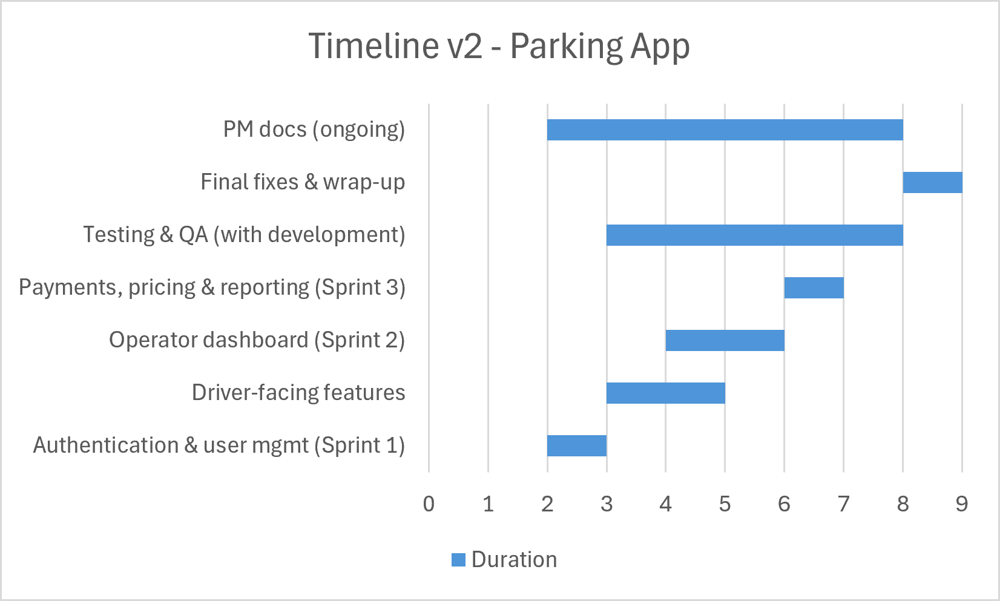
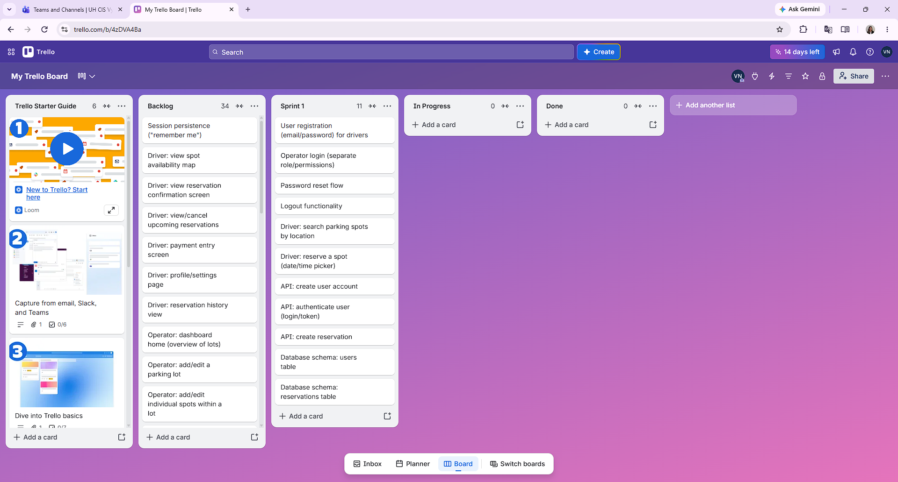
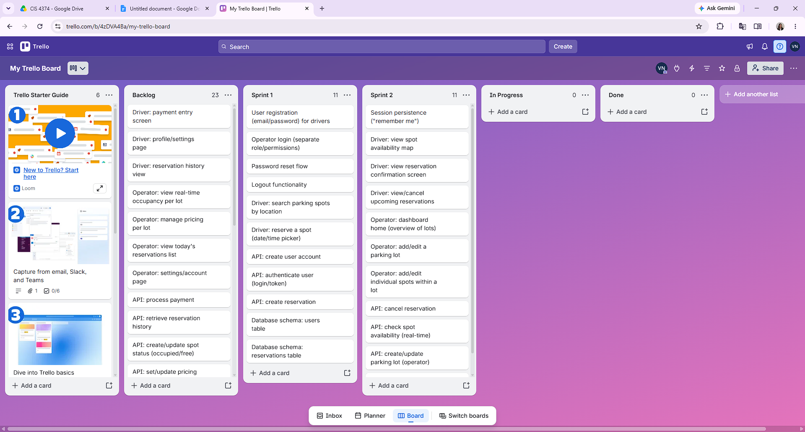

# Semester Project: Smart Parking Platform

**Version:** 0.7 (Week 7)
**Last updated:** October 29, 2026

## Table of Contents

1. [Project Overview](#project-overview)
2. [Business Need](#business-need)
3. [High-Level Requirements](#high-level-requirements)
4. [Stakeholders](#stakeholders)
5. [Development Teams](#development-teams)
6. [Project Constraints](#project-constraints)
7. [Research Component](#research-component)
8. [Work Breakdown Structure & Timeline](#work-breakdown-structure--timeline)
9. [Product Backlog & Sprint Planning](#product-backlog--sprint-planning)
10. [Risk Management & Communication Plan](#risk-management--communication-plan)
11. [Resource & Cost Management](#resource--cost-management)
12. [Weekly Update Log](#weekly-update-log)

---

## Project Overview

We are **$oftware ¢orp.**, a fictitious software development studio with unlimited resources and budget.

The project involves the planning and management of a software system that helps drivers locate, reserve, and pay for parking spaces in parking garages in real time. The platform will be available through web and mobile applications and will provide parking availability information, navigation assistance, and management tools for parking operators.

The goal is to develop a project management plan for the creation of this system, including requirements gathering, stakeholder management, scheduling, budgeting, risk management, and team coordination.

## Business Need

Drivers often spend significant time searching for available parking, leading to congestion, frustration, and lost productivity. Parking operators need better tools to monitor occupancy, manage pricing, and improve utilization of parking assets.

## High-Level Requirements

The platform should provide:

- User registration and authentication
- Real-time parking space availability
- Interactive map displaying available parking locations
- Parking reservation capability
- Digital payment processing
- Reservation history and receipts
- Administrative dashboard for parking operators
- Occupancy reporting and analytics
- Notifications and alerts for users
- Integration with external mapping/navigation services

Additional requirements will be identified through stakeholder analysis and requirements elicitation activities in upcoming weeks.

## Stakeholders

- Drivers and vehicle owners
- Parking facility operators
- City transportation departments
- System administrators
- Finance and billing personnel
- Mobile application users
- Third-party payment providers

## Development Teams

- Mobile Application Team
- Web Application Team
- Backend/API Team
- Mapping & Location Services Team
- Payment Integration Team
- Quality Assurance & Testing Team

## Project Constraints

- Unlimited theoretical development budget
- Fixed semester timeline
- Dependence on third-party services and APIs
- Compliance with security and privacy requirements, city ordinance & laws

## Research Component

## Work Breakdown Structure & Timeline

### Work Breakdown Structure (Parking App)

1. Smart Parking Platform
   1. Authentication & User Management
      1. User registration (driver)
      2. Operator registration
      3. Login / session management
      4. Password reset
      5. Role-based access (driver / operator / admin)
      6. Admin account management
   2. Driver-Facing Features
      1. Search & find available parking
      2. View garage details (price, hours, availability)
      3. Reserve a parking spot
      4. Payment processing
      5. Reservation confirmation & receipt
      6. Notifications
      7. Navigation to reserved spot
   3. Operator Dashboard
      1. Add / edit / remove garage
      2. Set pricing & availability rules
      3. Monitor real-time occupancy
      4. Manage reservations
   4. Reporting
      1. Occupancy graphs
      2. Revenue/financial reports
      3. Export reports (PDF/CSV)
   5. Project Management Docs
      1. Update PROJECT.md / VISION_AND_SCOPE.md / SRS.md
      2. Weekly video updates
      3. Sprint planning & backlog (Trello)
      4. Risk register & communication plan
      5. Resource & cost plan, RACI

### Draft Timeline

This is a rough draft timeline and will be refined as scope firms up.

| Phase | Weeks |
|---|---|
| Authentication & user management (Sprint 1) | 2–3 |
| Driver-facing features | 3–5 |
| Operator dashboard (Sprint 2) | 4–6 |
| Payments, pricing & reporting (Sprint 3) | 6–7 |
| Testing & QA (starts early, runs with development) | 3–8 |
| Final fixes & wrap-up | 8 |
| PM docs (ongoing) | 2–8 |

## Product Backlog & Sprint Planning

A full product backlog (45 items across Login, UI, Backend, and Reporting) was created and planned into Sprint 1 and Sprint 2 using Trello. See the board screenshots below.

**Sprint 1 goal:** Users can register/login, and drivers can search for and reserve a parking spot.

Sprint 1 scope (11 items):
- User registration (email/password) for drivers
- Operator login (separate role/permissions)
- Password reset flow
- Logout functionality
- Driver: search parking spots by location
- Driver: reserve a spot (date/time picker)
- API: create user account
- API: authenticate user (login/token)
- API: create reservation
- Database schema: users table
- Database schema: reservations table

**Sprint 2 goal:** Operators can manage lots and spots, and drivers can see availability and cancel reservations.

Sprint 2 scope (11 items):
- Session persistence ("remember me")
- Driver: view spot availability map
- Driver: view reservation confirmation screen
- Driver: view/cancel upcoming reservations
- Operator: dashboard home
- Operator: add/edit a parking lot
- Operator: add/edit individual spots within a lot
- API: cancel reservation
- API: check spot availability (real-time)
- API: create/update parking lot (operator)
- Database schema: parking lots/spots table

## Risk Management & Communication Plan

### Risks by Category

**Technical:** parking data sync errors, mapping API downtime, payment security issues, app inconsistency across platforms

**Schedule:** payment integration delays, dashboard scope creep, compressed testing time, vendor delays

**Financial:** API costs over budget, scope-change costs, hosting costs underestimated, payment fees cut into revenue

**People:** developer unavailable, team miscommunication, inexperience with tech stack, stakeholder unavailable for feedback

### Risk Register

| ID | Description | Probability | Impact | Owner | Response | Status |
|----|---|---|---|---|---|---|
| R01 | Parking data fails to sync | Medium | High | Backend Team | Mitigate | Open |
| R02 | Mapping API downtime | Medium | High | Mapping Team | Mitigate | Open |
| R03 | Payment security vulnerability | Low | High | Payment Team | Avoid | Open |
| R04 | App inconsistent across platforms | Medium | Medium | Mobile/Web Team | Mitigate | Open |
| R05 | Payment integration delayed | Medium | Medium | Payment Team | Accept | Monitoring |
| R06 | Dashboard scope creep | Medium | Medium | Web Team | Mitigate | Monitoring |
| R07 | Testing time compressed | Medium | High | QA Team | Mitigate | Open |
| R08 | API costs exceed budget | Medium | Medium | PM | Mitigate | Open |
| R09 | Developer unavailable | Medium | High | PM | Mitigate | Monitoring |
| R10 | Team miscommunication | Medium | Medium | PM | Mitigate | Open |
| R11 | Mapping vendor delays integration | Low | Medium | Mapping Team | Transfer | Open |
| R12 | Scope changes raise costs | Medium | Medium | PM | Mitigate | Open |
| R13 | Hosting costs underestimated | Low | Medium | Backend Team | Mitigate | Open |
| R14 | Payment fees reduce revenue | Low | Low | PM | Accept | Open |
| R15 | Team lacks tech stack experience | Medium | Medium | QA Team | Mitigate | Monitoring |
| R16 | Stakeholder unavailable for feedback | Low | Medium | PM | Accept | Open |

### Communication Plan

- **Weekly team sync** for each development team to review progress and blockers
- **Bi-weekly stakeholder update** summarizing progress, risks, and milestones
- **Reporting via:** Trello board, written updates in `PROJECT.md`, weekly video update

## Resource & Cost Management

### Roles & Resources

| Role | Name (fictional) | Skill Level | % Allocation |
|---|---|---|---|
| Project Manager | Alex Rivera | Senior | 25% |
| Backend Developer | Sam Patel | Mid-level | 100% |
| Frontend/Web Developer | Jordan Lee | Mid-level | 100% |
| Mobile Developer | Casey Nguyen | Mid-level | 75% |
| Mapping & Location Specialist | Morgan Diaz | Senior | 50% |
| Payment Integration Developer | Taylor Kim | Mid-level | 50% |
| QA/Test Engineer | Riley Chen | Junior | 75% |

### Resource Plan (Bottom-Up)

| Role | Name | FTE % | Estimated Hours | Hourly Rate | Cost |
|---|---|---|---|---|---|
| Project Manager | Alex Rivera | 25% | 80 | $60 | $4,800 |
| Backend Developer | Sam Patel | 100% | 320 | $55 | $17,600 |
| Frontend/Web Developer | Jordan Lee | 100% | 320 | $50 | $16,000 |
| Mobile Developer | Casey Nguyen | 75% | 240 | $50 | $12,000 |
| Mapping & Location Specialist | Morgan Diaz | 50% | 160 | $65 | $10,400 |
| Payment Integration Developer | Taylor Kim | 50% | 160 | $55 | $8,800 |
| QA/Test Engineer | Riley Chen | 75% | 240 | $35 | $8,400 |
| **Total** | | | **1,520** | | **$78,000** |

### Cost Plan & Monthly Cashflow

| Month | Planned Spend | Notes |
|---|---|---|
| Month 1 | $43,200 | Labor $42,000 + non-labor $1,200 |
| Month 2 | $36,800 | Labor $36,000 + non-labor $800 |
| Contingency reserve | $8,000 | Held back for risks (10% of $80,000) |
| **Total** | **$88,000** | |

### Non-Labor Costs

| Item | Cost |
|---|---|
| Cloud hosting (2 months) | $600 |
| Mapping API usage | $800 |
| Testing devices and tools | $600 |
| **Non-labor total** | **$2,000** |

### RACI Matrix

**R** = Responsible, **A** = Accountable, **C** = Consulted, **I** = Informed

| Task/Deliverable | PM (Alex) | Backend (Sam) | Web (Jordan) | Mobile (Casey) | Mapping (Morgan) | Payment (Taylor) | QA (Riley) |
|---|---|---|---|---|---|---|---|
| Authentication & login | A | R | C | C | I | I | C |
| Driver search & reservation | A | R | R | R | C | I | C |
| Operator dashboard | A | C | R | I | I | I | C |
| Payment processing | A | C | I | I | I | R | C |
| Mapping/navigation integration | A | C | I | I | R | I | C |
| Reporting features | A | R | R | I | I | I | C |
| Testing & QA | A | C | C | C | C | C | R |
| Weekly stakeholder updates | R | I | I | I | I | I | I |
| Sprint planning & backlog | A/R | C | C | C | I | I | C |
| Risk & budget tracking | A/R | I | I | I | I | I | I |

## Stakeholder Analysis & Charters

### Stakeholder Analysis (Power-Interest Grid)

| # | Stakeholder | Power | Interest | Strategy | What we do |
|---|---|---|---|---|---|
| 1 | Executive sponsor | High | High | Manage closely | Approves budget and scope. Gets a bi-weekly update and a say in big decisions. |
| 2 | Parking facility operators | High | High | Manage closely | They run the dashboard every day. Ask for feedback on every sprint demo. |
| 3 | City transportation departments | High | Low | Keep satisfied | Their rules must be followed. Check ordinances early and share compliance notes. |
| 4 | Third-party payment providers | High | Low | Keep satisfied | Their rules decide how payments work. Follow their security rules and test early. |
| 5 | Mapping service provider | High | Low | Keep satisfied | The map and navigation depend on them. Watch their service status and have a backup plan. |
| 6 | System administrators | Low | High | Keep informed | They manage accounts. Share release notes and the admin features. |
| 7 | Finance and billing personnel | Low | High | Keep informed | They use receipts and revenue reports. Show them the report designs. |
| 8 | Drivers and vehicle owners | Low | High | Keep informed | They are the main users. Share progress and collect feedback. |
| 9 | Mobile application users | Low | High | Keep informed | They use the mobile app. Test on phones and share updates. |
| 10 | Nearby businesses and residents | Low | Low | Monitor | Watch for complaints about traffic or parking. No regular updates needed. |

### Project Charter

| Item | Details |
|---|---|
| Project name | Smart Parking Platform |
| Company | $oftware ¢orp. (fictitious) |
| Project manager | Alex Rivera (fictional) |
| Executive sponsor | Jamie Torres (fictional) |
| Purpose | Help drivers find, reserve, and pay for parking in real time, and help operators manage their lots. |
| Business need | Drivers waste time searching for parking. Operators need better tools for occupancy and pricing. |
| Objectives | 1. Finish a working plan and build for web and mobile apps in 8 weeks. 2. Let drivers search, reserve, and pay for a spot. 3. Give operators a dashboard for lots, prices, and reports. 4. Stay within the $88,000 budget. |
| In scope | Driver and operator accounts, availability map, reservations, payments, receipts, operator dashboard, reports, notifications, navigation. |
| Out of scope | Hardware at the garages (gates, sensors), a public API for other companies, and support for countries outside the US. |
| Main deliverables | SRS, user stories, work breakdown, timeline, backlog and sprints, risk register, cost plan, RACI, weekly videos, and the working platform. |
| Milestones | Week 3: Sprint 1 done. Week 6: Sprint 2 done. Week 7: Sprint 3 done. Week 8: final fixes and wrap-up. |
| Budget | $88,000 total: $78,000 labor, $2,000 other costs, and an $8,000 reserve. |
| Assumptions | The team is available at the planned percentages. Payment and map services stay available. Requirements stay close to the SRS. |
| Constraints | Fixed 8-week schedule, third-party services, and security, privacy, and city rules. |
| Top risks | Parking data sync problems (R01), map service downtime (R02), and testing time getting too short (R07). |
| Success criteria | Drivers can reserve and pay for a spot. Operators can manage lots and see reports. The project finishes on time and within budget. |
| Authority | The project manager can move work between sprints and approve spending inside the plan. Budget or scope changes need the sponsor. |
| Approval | Jamie Torres, Executive Sponsor (fictional). Date: October 25, 2026. |

### Team Charter

**Team name:** Smart Parking Platform Team

**Team purpose:** Build the Smart Parking Platform on time and within budget, and keep clear, honest communication.

**Members and roles**

| Name | Role |
|---|---|
| Alex Rivera | Project Manager |
| Sam Patel | Backend Developer |
| Jordan Lee | Frontend/Web Developer |
| Casey Nguyen | Mobile Developer |
| Morgan Diaz | Mapping & Location Specialist |
| Taylor Kim | Payment Integration Developer |
| Riley Chen | QA/Test Engineer |

**Team values:** respect, honesty, quality over speed, and asking for help early.

**Ground rules**
- Hold a weekly team sync, and share updates through the Trello board.
- Reply to team messages within 1 business day.
- Say right away when work is late or blocked.
- Every task needs an owner, listed in the RACI matrix.
- Finish work before moving a Trello card to Done: it is built, tested, and reviewed by one other person.
- Review each other's work and give feedback kindly.

**Decisions:** The team talks first and tries to agree. If we cannot agree, the owner of that area decides. Scope, budget, or schedule changes go to the project manager and then the sponsor.

**Conflicts:** Talk to the person first. If it is not solved, bring it to the project manager. If it is still not solved, the sponsor decides.

**Team agreement:** Every member agrees to follow this charter.

## Weekly Update Log

### Week 1 — September 7, 2026

- Created public GitHub repository
- Drafted initial project document (overview, business need, high-level requirements, stakeholders, development teams, constraints)
- Recorded week 1 video update for stakeholders

### Week 2 — September 11, 2026

- Created Work Breakdown Structure (3+ levels deep) for the Parking App
- Drafted project timeline including Gantt chart
- Recorded week 2 video update for stakeholders

### Week 3 — September 24, 2026

- Created full product backlog (45 items) covering Login, UI, Backend, and Reporting for both driver and operator roles
- Planned Sprint 1 (11 items) in Trello
- Saved Sprint 1 board screenshot to `docs/sprint1-board.png`
- Recorded week 3 video update for stakeholders

### Week 4 — September 30, 2026

- Identified 4+ risks per category (technical, schedule, financial, people)
- Built a Risk Register with 10 entries
- Created a Communication Plan for team meetings and reporting
- Recorded week 4 video update for stakeholders

### Week 5 — October 4, 2026

- Defined project roles with fictional names, skill levels, and % allocations
- Built a bottom-up Resource & Cost Plan with estimated hours and total cost
- Created a monthly budgeted cashflow
- Created a RACI matrix for key project tasks
- Recorded week 5 video update for stakeholders

### Week 6 — October 15, 2026

- Updated SRS to v0.2: 5 new functional requirements, 2 new non-functional requirements, and 3 new use cases
- Added User Stories (12 stories)
- Updated the WBS, timeline, and Table of Contents
- Planned Sprint 2 and added a new Trello screenshot
- Completed the Risk Register (16 risks)
- Added non-labor costs and a contingency reserve to the Cost Plan, and updated the RACI
- Recorded week 6 video update for stakeholders

### Week 7 — October 25, 2026

- Created a stakeholder analysis with a Power-Interest Grid
- Wrote a project charter and a team charter
- Recorded week 7 video update for stakeholders